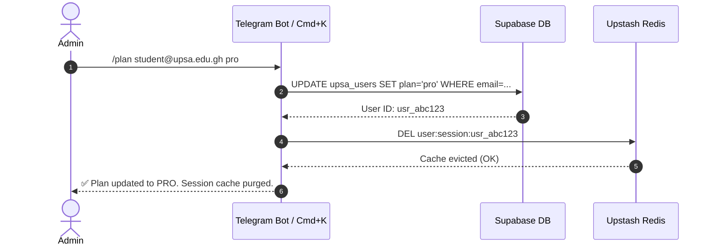
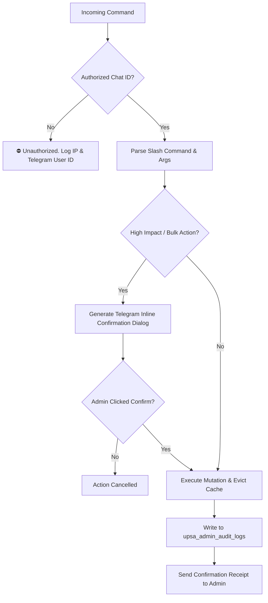

# Product Requirements Document (PRD)
## Project: PastQ Admin Command Suite & Remote Operations
**Document Version:** 1.0  
**Status:** Ready for Implementation  
**Target Systems:** PastQ Admin Telegram Bot CLI (`server/src/lib/telegram.ts`) & Web Admin Command Palette (`Cmd+K`)  
**Explicit Exclusions:** Paper and Subject creation/ingestion (maintained exclusively via Web Workspace)

---

## 1. Executive Summary & Objective

PastQ administrators currently face operational friction when executing time-critical, high-impact administrative tasks (e.g., student support requests, manual billing upgrades, server maintenance, emergency announcements, and email broadcasts). Currently, simple interventions require navigating through multi-step web forms or being tethered to a desktop workstation.

This PRD defines the specifications for extending **Admin Commands** to execute essential platform actions directly through two command interfaces:
1. **Telegram Bot Remote Command Interface**: On-the-go administrative actions triggered via secure Telegram slash commands.
2. **In-Dashboard Command Center (`Cmd+K`)**: Rapid keyboard-first execution within the web admin console.

### Key Focus Areas:
- **Email Broadcasts & Targeted Messaging**: Mass and individual communications with templating.
- **Subscription & Plan Control**: Instant permanent and temporary tier assignments with real-time session eviction.
- **Student Moderation & Quota Controls**: User lookups, account suspensions, AI tutor toggles, and limit resets.
- **System & Cache Operations**: Redis cache invalidation, banner updates, AI kill switches, and cron retry automation.

---

## 2. Explicit Scope & Non-Goals

```mermaid
graph TD
    subgraph IN SCOPE - Command Operations
        A1[Email Broadcasts & Single Messages]
        A2[Plan Assignment & Temporary Grants]
        A3[User Moderation, Bans & Quota Resets]
        A4[System Ops, Redis Cache Flush, Cron Retries]
        A5[Global Banners & Global AI Master Switch]
    end

    subgraph OUT OF SCOPE - Excluded by Design
        B1[Paper Upload & PDF Parsing]
        B2[OCR Vision Scanning & Question Ingestion]
        B3[Subject Creation & Department Mapping]
        B4[Direct SQL Schema Mutations]
    end

    Admin[PastQ Admin] -->|Commands / Slash Actions| IN SCOPE
    Admin -.->|Desktop Web UI Only| OUT OF SCOPE
```

### 2.1 Strictly In-Scope
- **Email Broadcasts** (all verified students) and individual student emails with placeholder support (`{{name}}`, `{{first_name}}`).
- **Plan Modifications**: Permanent plan upgrades/downgrades (`free`, `basic`, `plus`, `pro`).
- **Temporary Plan Grants**: E.g., 5-day Pro access during exam week with automated expiration timestamps.
- **Individual User Lookup & Moderation**: Status transitions (`active`, `suspended`, `deactivated`), AI tutor toggling, and quota resets.
- **In-App Notification Pushes**: Push announcements directly to student notification feeds.
- **Cache Invalidation**: Evicting user sessions from Upstash Redis (`invalidateCachedSession`).
- **Cron Maintenance**: Triggering digests and retrying failed email deliveries.

### 2.2 Explicit Exclusions (Non-Goals)
- **Paper Creation & Ingestion**: Adding exam papers requires multi-page PDF uploads, multipart form processing, OCR text extraction, Gemini vision scanning, and question verification. This remains solely in [AdminPapersPage.tsx](../src/pages/AdminPapersPage.tsx).
- **Subject Management**: Creating subjects requires faculty hierarchies, semester associations, academic codes, and color asset assignments. This remains solely in [AdminSubjectsPage.tsx](../src/pages/AdminSubjectsPage.tsx).

---

## 3. User Personas & Use Cases

| Persona | Scenario | Desired Command Solution |
| :--- | :--- | :--- |
| **Mobile Lead Admin** | Away from desk when a student pays via mobile money and needs immediate manual activation. | `/plan student@upsa.edu.gh plus` via Telegram |
| **Community Manager** | Needs to notify students about scheduled maintenance in 1 hour. | `/broadcast Exam System Alert \| Maintenance starting at 11 PM` |
| **Support Operator** | Student ran out of daily AI queries right before an exam. | `/resetlimits student@upsa.edu.gh` or `/tempplan student@upsa.edu.gh basic 3` |
| **DevOps / On-call** | Background cron failed or Redis has stale session locks. | `/cache flush session:usr_123` or `/cron retry` |

---

## 4. Command Specifications & Catalog

### 4.1 Subscription & Plan Assignment Commands

| Command | Arguments | Behavior | Confirmation Required |
| :--- | :--- | :--- | :--- |
| `/plan` | `<email> <free\|basic\|plus\|pro>` | Sets student's permanent subscription tier in `upsa_users`. Evicts session from Redis to apply changes instantly. | No (immediate with receipt) |
| `/tempplan` | `<email> <basic\|plus\|pro> <days>` | Grants temporary access tier for `$days` days. Sets `temp_plan_expires_at` in Supabase. | No |
| `/tempplan_all` | `<plan> <days>` | Mass grants temporary plan to all active students (e.g., exam promos). | **Yes** (Interactive inline button) |
| `/revokeplan` | `<email>` | Immediately reverts student back to `free` plan and clears temporary expiration timestamps. | No |

#### Plan Execution Flow:


---

### 4.2 Messaging & Broadcast Commands

#### 1. `/broadcast` — Mass Email Broadcast
- **Syntax**: `/broadcast <subject> | <title> | <body>`  
- **Interactive Multi-Step Mode**:
  1. Admin sends `/broadcast`.
  2. Bot prompts: `Please enter Email Subject:`
  3. Bot prompts: `Please enter Title & Body message:`
  4. Bot presents confirmation card with total recipient count:
     ```
     📧 Confirm Mass Broadcast
     Recipient Count: 1,420 verified students
     Subject: 🚨 Exam Study Prep Week
     Includes in-app notification: [Toggle: Yes/No]
     [✅ Confirm & Send]  [❌ Cancel]
     ```
  5. Upon confirmation, triggers `/hq-management/broadcast` queue in chunks of 50 to respect SMTP rate limits.

#### 2. `/email` — Direct Single Student Email
- **Syntax**: `/email <email> | <subject> | <title> | <body>`
- **Behavior**: Sends transactional styled PastQ email to the specified student using the standard branded template.

#### 3. `/broadcast_retry` — Retry Failed Email Deliveries
- **Syntax**: `/broadcast_retry <broadcastId>`
- **Behavior**: Re-queries failed recipient IDs from `upsa_broadcast_logs` and executes failover delivery attempts.

---

### 4.3 Student Moderation & Quota Controls

| Command | Arguments | Behavior |
| :--- | :--- | :--- |
| `/user` | `<email>` | Displays rich profile: Plan, Join date, Account status, AI queries used (30d), PDF download counts, AI tutor status. |
| `/suspend` | `<email>` | Updates `status = 'suspended'`. Student receives 403 on next request. Redis session revoked. |
| `/activate` | `<email>` | Restores suspended account to `status = 'active'`. |
| `/aiuser` | `<email> <on\|off>` | Toggles individual AI tutor access (`ai_enabled = true/false`) without affecting paper downloads. |
| `/resetlimits` | `<email>` | Clears `queries_10h`, `pdf_downloads_count`, and resets `pdf_downloads_blocked_until` to `null`. |

#### Sample Output for `/user john@upsa.edu.gh`:
```text
👤 User Profile: John Doe
━━━━━━━━━━━━━━━━━━━━
📧 Email: john@upsa.edu.gh
🎖️ Tier: PRO (Permanent)
🟢 Status: Active
🤖 AI Tutor: Enabled
📊 30-Day AI Queries: 142
📥 PDF Downloads: 28
📅 Joined: 14 Sep 2026

[⚡ Reset Limits]  [🚫 Suspend]  [🔄 Change Plan]
```

---

### 4.4 System Maintenance, Cache & Operations

| Command | Arguments | Behavior |
| :--- | :--- | :--- |
| `/cache flush` | `<user_id \| all>` | Deletes session cache keys from Upstash Redis. `/cache flush all` clears all `user:session:*` keys. |
| `/cron retry` | None | Retries failed weekly digests or automated cron tasks logged in `upsa_cron_failures`. |
| `/cron test` | None | Triggers immediate dry-run execution of weekly digest generation and delivers preview to Admin chat. |
| `/fallbacks` | None | Displays real-time breakdown of recent model fallbacks (Primary model vs Fallback route, error codes). |
| `/fallbacks clear`| None | Clears all resolved fallback monitoring logs. |
| `/banner set` | `<text>` | Updates global banner message and enables it across the student portal. |
| `/banner on/off`| None | Toggles site-wide announcement banner visibility. |
| `/ai on/off` | None | Master kill switch for all student AI tutor requests. |

---

## 5. Security & Safety Architecture



### 5.1 Telegram Bot Security Rules
1. **Chat ID Whitelist**: Strict matching against `process.env.TELEGRAM_CHAT_ID`. Multi-admin support using comma-separated IDs (`TELEGRAM_ALLOWED_ADMIN_IDS`).
2. **Two-Factor Action Guard**: Any action affecting more than 1 user (e.g., `/broadcast`, `/tempplan_all`, `/cache flush all`) requires inline button confirmation.
3. **Audit Trail**: Every executed command records an entry in `upsa_admin_audit_logs` containing `admin_identifier`, `command`, `target_user`, `timestamp`, and `execution_status`.
4. **Input Sanitization**: Email parameters must match RFC 5322 regex. Markdown output escaped to prevent Telegram parsing crashes.

---

## 6. Implementation Technical Architecture

### 6.1 Backend Handlers (`server/src/lib/telegram.ts`)
New command modules to be registered in `registerCommands(bot: Bot)`:
- `handlePlanCommands(bot)`: `/plan`, `/tempplan`, `/revokeplan`
- `handleBroadcastCommands(bot)`: `/broadcast`, `/email`, `/broadcast_retry`
- `handleUserModerationCommands(bot)`: `/user`, `/suspend`, `/activate`, `/aiuser`, `/resetlimits`
- `handleSystemOpsCommands(bot)`: `/cache`, `/cron`, `/fallbacks`

### 6.2 Redis Cache Invalidation Hook
Whenever an admin modifies a user's plan or status via command:
```typescript
import { invalidateCachedSession } from './redis';

// Immediately evict session cache so updates reflect live on next request
await invalidateCachedSession(targetUserId);
```

---

## 7. Delivery Roadmap & Acceptance Criteria

### Phase 1: Subscription & Plan Assignment
- [ ] Implement `/plan <email> <plan>` with Redis cache eviction.
- [ ] Implement `/tempplan <email> <plan> <days>` with timestamp calculation.
- [ ] Implement `/user <email>` profile summary viewer.

### Phase 2: Moderation & Quota Controls
- [ ] Implement `/suspend`, `/activate`, `/aiuser`, and `/resetlimits`.
- [ ] Implement confirmation modals/buttons for destructive user actions.

### Phase 3: Email Broadcasts & Notifications
- [ ] Implement `/email` single recipient handler.
- [ ] Implement `/broadcast` interactive flow with confirmation step.
- [ ] Implement `/broadcast_retry` for failed deliveries.

### Phase 4: System Operations & Cmd+K Bridge
- [ ] Implement `/cache flush`, `/cron retry`, and `/fallbacks`.
- [ ] Integrate corresponding action shortcuts into the web admin dashboard command palette.

---

## 8. Summary Table of Excluded vs Included Features

| Feature Category | Inclusion Status | Rationale |
| :--- | :---: | :--- |
| **Email Broadcasts** | ✅ Included | High-value remote action; easily triggered via text/command templates. |
| **Plan / Tier Assignment** | ✅ Included | Critical for real-time customer support and manual billing reconciliations. |
| **Temporary Plan Grants** | ✅ Included | Quick turnaround needed for exam promos and student compensations. |
| **User Ban / Quota Reset** | ✅ Included | Immediate moderation response when students hit false-positive limits. |
| **Cache & System Controls** | ✅ Included | DevOps operational convenience from mobile device. |
| **Paper Creation & Ingestion** | ❌ **Excluded** | Requires multipart file uploads, OCR pipelines, vision verification, and QA. |
| **Subject Creation** | ❌ **Excluded** | Requires relational academic code setup, faculty mapping, and styling badges. |
